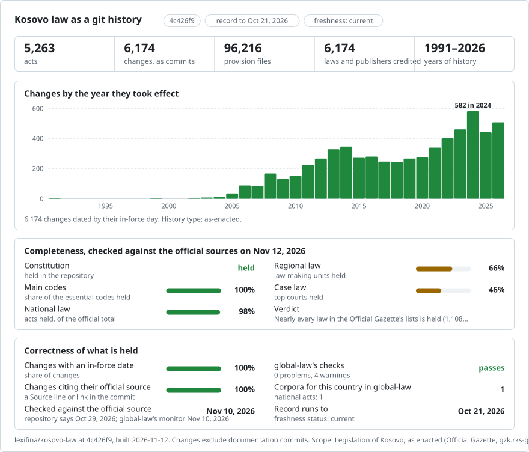

# Kosovo: law history in git

**English** · **[Ose lexojeni në shqip](README.md)**

<picture>
<source media="(prefers-color-scheme: dark)" srcset="data/effort-dark.svg">

</picture>

The law of Kosovo as a git history: one file per article, one commit per act on the day it took effect, and the act itself as the commit's author. The Official Gazette keeps no dated consolidated versions, so each act is held as enacted: an amending act is a commit of its own, and its changes are not applied to the act it amends. `git blame` names the act behind every article; `git log` gives the day each act took effect; picking a date gives the acts in force that day, as enacted.

Part of [lexifina/global-law](https://github.com/lexifina/global-law), one git history for every country's law: this is Kosovo's national law, which global-law reads at `kosovo/national/acts/`.

**What is in it now:** from the Gazette's list of laws, the 2008 Constitution and its five amendments, 1,020 laws, 10 codes, 11 Constitutional Court judgments and 1 order, with the Gazette's English translation; and 5,061 acts of its other categories, one text each: 2,731 judgments, resolutions and judges' opinions, almost all of the Constitutional Court; 653 administrative instructions, 645 decisions, 512 regulations, 179 international agreements, 78 further laws and 33 decrees, statutes and other acts; and 230 acts of 25 municipalities. [`laws.csv`](laws.csv) lists the acts of the list of laws with their dates and status; [`registry/ACTS.md`](registry/ACTS.md) lists the others, by kind.

Each act of the list of laws is in `<kind>/<number>/` (`ligje/03-l-212/` is Ligji Nr. 03/L-212 i Punës, the Labour Law, Official Gazette 90/2010; the Constitution is `kushtetuta/2008/`); the other acts are in `<kind>/<year>/<Gazette id>/` (`rregullore/2020/30885/`), and municipal acts in `local/<municipality>/<year>/<id>/`.

The text is in Albanian, as the Official Gazette publishes it; the Gazette's own English translation of the acts of the list of laws is under `en/` (`en/ligje/03-l-212/article-001.md`).

## Questions as git commands

| Question | Command |
| --- | --- |
| Which acts amend or repeal the Labour Law, as the Gazette links them? | `grep '^2735,' data/amendments.csv` |
| Which act wrote each line of Article 1? | `git blame ligje/03-l-212/neni-001.md` |
| The Labour Law's commit, with the day it took effect | `git log --format="%h %(trailers:key=In-force,valueonly,separator=) %an" -- ligje/03-l-212` |
| Article 1 as held on 1 January 2015 | `python tools/in_force_on.py 2015-01-01 ligje/03-l-212 neni-001` |

**Outside git**, we also host this record publicly, for free:

- **[Ask Claude about Kosovan law](https://global-law.lexifina.com/v1/try_claude?country=kosovo)**: opens Claude with a first question ready.
- **[Ask ChatGPT](https://global-law.lexifina.com/v1/try_chatgpt?country=kosovo)**: the same question in ChatGPT.
- **[Call the API in your browser](https://global-law.lexifina.com/v1/search_law?query=pushimi+vjetor&jurisdictions=kosovo)**: a search of Kosovan law for "pushimi vjetor", returned as JSON. See the [documentation here](https://lexifina.com/api/global-law).

Both assistants read the record through the free Global law connector (MCP, `https://global-law.lexifina.com/mcp`); the first time, the chat gives you the link that adds it. Ask in Albanian or in English.

**Host it yourself easily.** All it takes is git and Python, and the tools run on your machine:

```sh
git clone --depth 1 https://github.com/lexifina/global-law && cd global-law
python3 tools/countries.py add kosovo/national/acts
python3 tools/law.py show 2026-01-01 kosovo/national/acts/ligje/03-l-212/neni-001.md
```

Opened in Claude Code, Cursor, VS Code or Codex, the clone also starts a local MCP server with the same tools ([MCP.md](https://github.com/lexifina/global-law/blob/main/MCP.md)).

## Dates

Each commit is dated at noon, Kosovo time (Europe/Belgrade), on the day the act took effect, and carries it in its `In-force:` trailer:

- the day the act's own in-force article ("Hyrja në fuqi") gives: a number of days after publication in the Gazette, the day of publication, a date, or a period after publication;
- for laws of 2001-2008 that took effect on promulgation, and 17 acts of the list of laws with no rule found, the day the Gazette published them, labelled `In-force-basis: published (...)`;
- where parts of an act take effect later, its first day, with the whole rule quoted in `In-force-rule:`; the 13 acts that took effect before the Gazette published them (budget laws on 1 January, some laws of 2002-2005) say `In-force-before-publication: yes`;
- an act of the other categories whose in-force day cannot be read is held back, not guessed ([`data/held.json`](data/held.json)).

Each commit's author is the act itself, at an address that cannot exist (`Ligji Nr. 03/L-212 <ligji-03-l-212@gzk.invalid>`), so `git blame` always names the act whose own text it is. The commit of an act that repealed acts of the list of laws also deletes their files, and names them in `Repeals:` lines.

## How current it is

<!-- freshness-summary -->
Checked against the official sources: 2026-11-10; 100% of acts verified in the last 7 days, 100% in the last 30 ([data/freshness.json](data/freshness.json)).
<!-- /freshness-summary -->

- `python tools/freshness.py <act id or folder>` gives an act's status, its last check and its page at the Gazette.
- [data/status.json](data/status.json): when the refresh run last read the Gazette and whether it answered; [data/pending.json](data/pending.json): acts published but not yet in force.

## How it is checked

- The letters of every text of the list of laws, in both languages, are compared with the Gazette's raw text layer or PDF, read by a separate minimal extractor (`tools/build/check_words.py`): of 2,082 texts, 2,009 have every letter in place, 70 the same words in another order (table cells and OCR layers), 2 differ only where letter-spaced words break, and 1 differs in letters (in `REPRODUCE.md`).
- Every commit has `In-force:`; `main` has no merges, its dates never go backwards or past the build day, and every commit is at noon.
- The build is deterministic: two builds from the same pages give the same `main` hash, and the sha256 of every page and PDF read is in [`data/source-sha256.tsv`](data/source-sha256.tsv).
- The acts of the other categories are written from one corpus file (`registry/REPRODUCE.md`), which `registry/tools/build/check_repo.py` compares with every version in git; `registry/REPRODUCE.md` does not yet record a run.

## What it does not show

- **Amendments applied to the text.** Read the amending acts alongside the act ([`data/amendments.csv`](data/amendments.csv), 1,117 links). Since 2024-09-26 the Gazette has published one consolidated text each for 156 laws ([`data/consolidated.csv`](data/consolidated.csv)); they are not used as history.
- **8,107 acts of the Gazette not yet here**, listed in [`data/held.json`](data/held.json) with the reason: 5,460 printed only as page scans, 1,427 whose in-force day could not be read, 578 not in Albanian, and 642 for other reasons.
- **The Serbian texts.** Albanian and Serbian are both official languages (Constitution, art. 5); only the Albanian text, and the Gazette's English translation, are used.
- **Images and layout.** Annex pages printed only as scans (4,052 in acts of the list of laws), tables as tables, footnotes and images are not in the files.
- **Every repeal as a deletion.** Only acts of the list of laws repealed by another act in it lose their files; the others keep them, and `registry/data/acts.json` gives their status (370 marked repealed).

## Sources

| Source | Kind | Past versions | Notes |
| --- | --- | --- | --- |
| [Gazeta Zyrtare e Republikës së Kosovës](https://gzk.rks-gov.net) (Official Gazette) | Official Gazette: every kind of act, national and municipal | no, each act as enacted | Albanian text, its English translation for the list of laws, and the links between acts |
| Municipal websites ([Fushë Kosovë](https://fushekosove.rks-gov.net), [Deçan](https://decan.rks-gov.net)) | Municipal acts | as published | 3 acts the Gazette does not publish |

## Licence

See [`LICENSE`](LICENSE). Under Law No. 08/L-205 on Copyright and Related Rights, article 6(1), copyright does not extend to official texts of a legislative, administrative and judicial nature, nor to their official translations; the texts are reproduced without change to their wording. Lexifina's own contributions (tools, arrangement, commit messages and documentation) are CC0 1.0.

No AI model wrote, translated or changed legal text, and none runs when the history is built; the scripts were written by an AI model (see [`REPRODUCE.md`](REPRODUCE.md) and [`registry/REPRODUCE.md`](registry/REPRODUCE.md)).

## More

From [lexifina/global-law](https://github.com/lexifina/global-law):

- [FEATURES.md](https://github.com/lexifina/global-law/blob/main/FEATURES.md): every feature, and what every corpus must support (`git blame`, `law.py`, the MCP tools)
- [FAQ.md](https://github.com/lexifina/global-law/blob/main/FAQ.md): questions and answers · [CONTRIBUTING.md](https://github.com/lexifina/global-law/blob/main/CONTRIBUTING.md): proposing changes · [MCP.md](https://github.com/lexifina/global-law/blob/main/MCP.md): the MCP server · [REPRODUCE.md](https://github.com/lexifina/global-law/blob/main/REPRODUCE.md): how it was built · [CHANGELOG.md](https://github.com/lexifina/global-law/blob/main/CHANGELOG.md)
- [FRESHNESS.md](https://github.com/lexifina/global-law/blob/main/FRESHNESS.md): how current each corpus is · [Monitoring](https://github.com/lexifina/global-law/tree/main/monitoring): whether updates are running · [WATCHING.md](https://github.com/lexifina/global-law/blob/main/WATCHING.md): how each official source is watched for changes
- [performance/](https://github.com/lexifina/global-law/tree/main/performance): how fast the tools are, measured
- [visualisations/](https://github.com/lexifina/global-law/tree/main/visualisations): charts and bridges across the world's law
- [Vulnerabilities](https://github.com/lexifina/global-law/tree/main/vulnerabilities): mistakes in legislation as published
