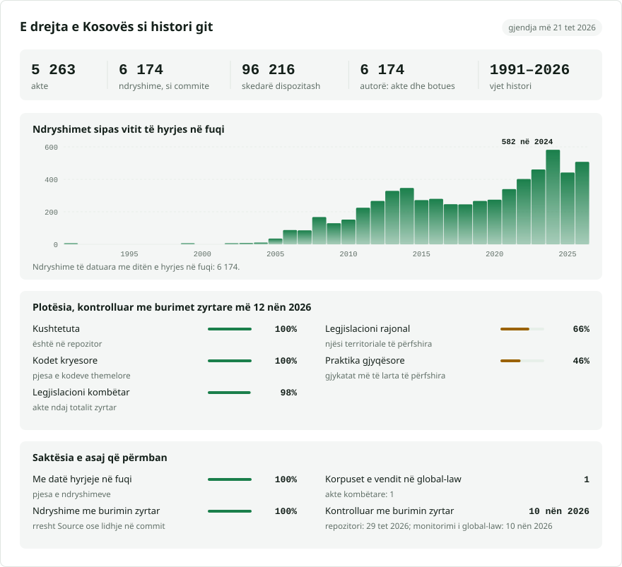

# Legjislacioni i Kosovës, akt pas akti, siç është miratuar

**Shqip** · [English](README.en.md)

<picture>
<source media="(prefers-color-scheme: dark)" srcset="data/sq/effort-dark.svg">

</picture>

Pjesë e [lexifina/global-law](https://github.com/lexifina/global-law), një histori e vetme git për legjislacionin e çdo vendi: ky është legjislacioni kombëtar i Kosovës, të cilin global-law e lexon te `kosovo/national/acts/`.

Legjislacioni i Kosovës si repozitor git: 1.048 akte nga [Gazeta Zyrtare e Republikës së Kosovës](https://gzk.rks-gov.net), botuesi zyrtar, secili **siç është miratuar**: 1.020 ligje; 11 aktgjykime të Gjykatës Kushtetuese; 10 kode; 6 akte të Kushtetutës së vitit 2008 dhe të amendamenteve të saj; 1 urdhër. Për çdo akt ka një dosje dhe për çdo nen një skedar, në shqip, ndërsa përkthimi në anglisht i Gazetës gjendet në një pemë paralele nën `en/`. Çdo akt është një commit, që i atribuohet vetë aktit dhe mban datën e ditës kur akti hyri në fuqi, në mesditë sipas orës së Kosovës.

**Çfarë lloj historie është kjo.** Gazeta Zyrtare e boton çdo akt siç është miratuar. Ajo nuk mban një seri të datuar versionesh të konsoliduara të ligjeve që ndryshon: që nga 2024-09-26 ka botuar 156 tekste të vetme të konsoliduara ("(KONSOLIDUAR)", një për ligj, secili sipas gjendjes në ditën e botimit), të cilat renditen me datat e botimit në [`data/consolidated.csv`](data/consolidated.csv), por nuk përdoren si histori. Prandaj ky regjistër është **siç është miratuar** (`"history": "as-enacted"` në [`corpus.json`](corpus.json)): skedarët e një akti përmbajnë tekstin me të cilin akti është miratuar, dhe **ndryshimet e mëvonshme nuk zbatohen në to**. Një ligj ndryshues është akt më vete, në dosjen e vet, dhe thotë se çfarë ndryshon ("Neni 6 i ligjit bazik, pas paragrafit 2, shtohet paragrafi i ri 3 ..."). Cili akt ndryshon, plotëson ose shfuqizon cilin renditet në [`data/amendments.csv`](data/amendments.csv) (1.117 lidhje, ashtu siç i jep Gazeta). Nuk ka histori rresht për rresht të tekstit të konsoliduar të asnjë ligji, dhe asnjë histori para fillimit të regjistrit. Zbatimi i ndryshimeve në tekste nuk u provua, sepse për shumicën e ligjeve nuk ka konsolidim zyrtar me të cilin të krahasohet rezultati, ndërsa për të tjerët ka vetëm një, të kohëve të fundit.

Regjistri shtrihet nga 2002-07-26 deri më 2026-10-21 në 1.049 commit-e në `main`. 0 akte të tjera, të botuara por që hyjnë në fuqi pas 2026-10-29, gjenden në degën `future`, e cila nuk bashkohet kurrë. Skedarët e një akti të shfuqizuar fshihen në ditën kur hyri në fuqi akti që e shfuqizoi (256 akte).

**Dy ndërtime, një histori.** Aktet e mësipërme janë ndërtimi i parë ([`laws.csv`](laws.csv) në rrënjë). Që nga 2026-11-03, i njëjti `main` përmban edhe aktet e kategorive të tjera të Gazetës (udhëzime administrative, rregullore, vendime të Qeverisë, dekrete, marrëveshje ndërkombëtare, statute, aktgjykimet dhe vendimet e Gjykatës Kushtetuese, si dhe ligjet që lista e ndërtimit të parë nuk i përfshinte), secili siç është botuar, me nga një version, në dosje `<kind>/<year>/<id>/`; ato renditen në [registry/ACTS.md](registry/ACTS.md) dhe [registry/data/acts.json](registry/data/acts.json) dhe ndërtohen siç përshkruhet në [registry/REPRODUCE.md](registry/REPRODUCE.md).

## Pyetjet e një juristi si komanda git

Dosja e çdo akti është `<kind>/<number>/`, e renditur me titullin, datat dhe statusin në [`laws.csv`](laws.csv): `kushtetuta/2008` (Kushtetuta siç u miratua në vitin 2008), `ligje/03-l-199` (Ligji Nr. 03/L-199 për Gjykatat, 2010, i shfuqizuar në vitin 2019), `ligje/06-l-054` (Ligji Nr. 06/L-054 për Gjykatat, që e shfuqizoi atë), `kode/06-l-074` (Kodi Penal i vitit 2019).

| Pyetja | Komanda |
| --- | --- |
| Çfarë thoshte neni 43 i Ligjit Nr. 03/L-199 dhe a ishte në fuqi më 1 janar 2015? | `python tools/in_force_on.py 2015-01-01 ligje/03-l-199 neni-043` |
| I gjithë akti në një datë (në shqip; në anglisht nën `en/`) | `python tools/in_force_on.py 2015-01-01 en/ligje/03-l-199` |
| A ishte ende në fuqi më 1 mars 2019? | `python tools/in_force_on.py 2019-03-01 ligje/03-l-199` (përgjigjet "repealed by then") |
| Duke numëruar edhe aktet e botuara, por ende jo në fuqi | `python tools/in_force_on.py --future 2027-01-01 <folder>` |
| Cilat akte e ndryshojnë Ligjin Nr. 03/L-199? | `grep '^2700,' data/amendments.csv`, ose kërkoni në skedar `03/L-199` |
| Kur hyri në fuqi një akt dhe pse pikërisht atë ditë? | `git log -1 --format='%(trailers)' -- ligje/03-l-199/neni-001.md` (`In-force:`, `In-force-basis:`, `In-force-rule:`) |
| Të gjitha aktet që hynë në fuqi në vitin 2020 | `git log --format='%(trailers:key=In-force,valueonly,separator=) %s' \| grep '^2020'` |
| Cili akt e shfuqizoi këtë? | `git log --diff-filter=D --format='%an %(trailers:key=In-force,valueonly)' -- ligje/03-l-199` |
| Kush e shkroi një rresht? | `git blame kode/06-l-074/neni-001.md` (gjithmonë vetë akti: asgjë nuk ndryshohet në vend) |
| Commit-et deri në një ditë të caktuar, pa befasi nga zonat kohore | `git log --before='2019-01-01T23:59:59+01:00' -1` |

Në PowerShell, `git show $(...):path` ndahet në dy argumente; përdorni `$r = git rev-list -1 main -- ligje/03-l-199; git show "$($r):ligje/03-l-199/neni-043.md"`.

Skedarët: `hyrje.md` përmban titullin dhe formulën e miratimit, `neni-001.md` ... nga një nen secili (titulli `# Neni 1`, emërtimi i nenit, pastaj një rresht për çdo paragraf; titujt e kapitujve mbi një nen si rreshta `##`), `nenshkrimi.md` bllokun e nënshkrimit dhe të shpalljes. Në `en/` të njëjtët skedarë janë `preamble.md`, `article-001.md` ... dhe `signature.md`; tekstet në anglisht të periudhës së UNMIK-ut i quajnë nenet e tyre "Section" dhe e ruajnë këtë fjalë në titull. Një akt pa nene të numëruara (aktgjykimet e Gjykatës Kushtetuese, amendamentet kushtetuese) është një skedar i vetëm, `teksti.md` / `text.md`. Titujt e neneve merren vetëm sipas radhës (1, 2, 3 ...), kështu që nenet që citon një ligj ndryshues mbeten brenda nenit që i citon.

## Datat dhe cilën prej tyre përdorim

**Commit-et datohen sipas ditës kur akti hyri në fuqi**, e cila lexohet nga neni i vetë aktit për hyrjen në fuqi ("Hyrja në fuqi"):

- "hyn në fuqi pesëmbëdhjetë (15) ditë pas publikimit në Gazetën Zyrtare" (N ditë pas publikimit): data e publikimit plus N ditë. 693 akte.
- "hyn në fuqi ditën e publikimit" (në ditën e publikimit): data e publikimit. 161 akte.
- Një datë në akt ("hyn në fuqi më 1 janar 2011"; një muaj i vetëm, "në janar të vitit 2017", lexohet si dita e parë e tij): ajo datë. 44 akte. Ligjet për buxhetin shpesh hyjnë në fuqi më 1 janar, para se të botohen, dhe disa ligje të viteve 2002–2005 u botuan në Gazetë vetëm më vonë; këto commit-e shënojnë `In-force-before-publication: yes`.
- Muaj ose vite pas publikimit: data e publikimit plus ajo periudhë. 22 akte.
- Me shpalljen nga Përfaqësuesi Special i UNMIK-ut ose nga Presidenti (ligjet e viteve 2001–2008): data e publikimit në Gazetë, e shënuar `In-force-basis: published (the act takes effect on promulgation; ...)`. 111 akte.
- Nuk u gjet asnjë rregull, ose rregulli nuk ka datë: data e publikimit, e shënuar `In-force-basis: published (...)`. 17 akte.

Teksti në shqip lexohet i pari, ai në anglisht atje ku teksti në shqip nuk ka rregull. Çdo commit mban `In-force:`, `In-force-basis:`, `In-force-rule:` (fjalët e aktit), `Published:` dhe `Gazette:`. Atje ku pjesë të një akti hyjnë në fuqi në data të tjera ("... hyn në fuqi më 1 janar 2011 për nenet 29, 35 ... kurse për nenet e tjera fillon të zbatohet nga 1 janari 2013"), commit-i ka datën e parë dhe i gjithë rregulli citohet në `In-force-rule:`.

## Çfarë do të thotë "autor"

Autori i çdo commit-i është vetë akti, me një adresë që nuk mund të ekzistojë: `Ligji Nr. 03/L-199 <ligji-03-l-199@gzk.invalid>`. Meqë asgjë nuk ndryshohet në vend, `git blame` përmend gjithmonë aktin të cilit i përket teksti. Commit-i i një akti që ka shfuqizuar akte të tjera fshin edhe skedarët e tyre dhe e shënon këtë në rreshtat `Repeals:`.

## Çfarë nuk tregon

- **Ndryshimet e zbatuara në tekst.** Lexoni aktet ndryshuese (shih `data/amendments.csv`) së bashku me aktin. Shfuqizimet e pjesshme dhe aktgjykimet e Gjykatës Kushtetuese që shfuqizojnë dispozita janë gjithashtu lidhje atje, jo fshirje. Për 156 akte në këtë regjistër Gazeta ka botuar një tekst të konsoliduar (2024-09-26 deri më 2026-05-20); [`data/consolidated.csv`](data/consolidated.csv) e lidh secilin me dosjen e ligjit këtu, por teksti i tij nuk është pjesë e këtij regjistri.
- **Dokumente në anglisht që përmbajnë tekstin në shqip.** Për 13 akte dokumenti "në anglisht" i Gazetës përmban tekstin në shqip (për shumicën, i njëjti skedar PDF). Ato janë lënë jashtë `en/` dhe renditen në [`data/en-left-out.csv`](data/en-left-out.csv); teksti në shqip gjendet në dosjen e vetë aktit.
- **Tekstet e aneksuara si nene.** Një marrëveshje e ratifikuar ose një aneks i shtypur pas nënshkrimit të një ligji, i numëruar sërish nga neni 1, mbetet brenda skedarit të fundit të ligjit; nenet e tij nuk ndahen veçmas. Një aktgjykim i Gjykatës Kushtetuese është një skedar i vetëm (`teksti.md`), sepse titujt e neneve në të janë ata të ligjit që shqyrton.
- Tekstet në serbisht, të cilat Gazeta i boton gjithashtu (shqipja dhe serbishtja janë gjuhët zyrtare të Kosovës, Kushtetuta neni 5). Këtu përdoren vetëm teksti në shqip dhe përkthimi i vetë Gazetës në anglisht.
- Aktet nënligjore (rregulloret, udhëzimet administrative, vendimet e Qeverisë) dhe rregulloret e UNMIK-ut, përveç të paktave që janë në listën e ligjeve të Gazetës.
- Aneksët që Gazeta i boton vetëm si faqe të skanuara (marrëveshje të aneksuara ligjeve për ratifikim, tabela buxhetore): 4.052 faqe të skanuara nuk janë transkriptuar; rreshti përmbyllës `Text-sq:`/`Text-en:` i commit-it i numëron ato. Akte pa asnjë tekst: 1, i renditur në [`data/issues.csv`](data/issues.csv).
- Formatimi, tabelat si tabela (qelizat vijojnë njëra pas tjetrës në një rresht), fusnotat dhe imazhet.
- Aktet e shfuqizuara nga një akt jashtë këtij regjistri i ruajnë skedarët e tyre; `status_on_gzk` në `laws.csv` tregon cilat akte Gazeta i shënon si të shfuqizuara (256).

Ky është një mjet ndihmës për kërkime. Zyrtare janë vetëm tekstet e botuara në Gazetën Zyrtare të Republikës së Kosovës.

## Sa i përditësuar është

Çdo akt përmend faqen e vet zyrtare në Gazetë (rreshti përmbyllës `Source:` i commit-it të tij; `source` në [`laws.csv`](laws.csv), `portal` në [registry/data/acts.json](registry/data/acts.json)), kështu që çdo akt mund të verifikohet kundrejt saj.

<!-- freshness-summary -->
Verifikuar kundrejt burimeve zyrtare: 2026-11-10; 100% e akteve të verifikuara në 7 ditët e fundit, 100% në 30 ditët e fundit ([data/freshness.json](data/freshness.json)).
<!-- /freshness-summary -->

`python tools/freshness.py <act id or folder>` jep statusin e një akti, verifikimin e tij të fundit dhe lidhjen zyrtare. Regjistri mbahet i përditësuar nga një ekzekutim javor që lexon listat e akteve të Gazetës, shton aktet e sapobotuara dhe e riverifikon çdo akt kundrejt faqes së tij në Gazetë (Kushtetutën, kodet, ligjet, marrëveshjet, vendimet e Qeverisë dhe dekretet brenda 7 ditëve; aktet e tjera brenda 30 ditëve); [data/status.json](data/status.json) tregon kur u ekzekutua për herë të fundit dhe nëse Gazeta u përgjigj. Aktet brenda fushëveprimit që nuk janë botuar këtu renditen në [data/held.json](data/held.json) bashkë me arsyen; aktet e botuara, por ende jo në fuqi, në [data/pending.json](data/pending.json). Një akt i shënuar `amended, not consolidated` (ose `repealed, not consolidated`) në registry/data/acts.json përmban aktin siç është botuar dhe përmend aktet e mëvonshme që e ndryshojnë. Ligjet për ratifikim që Gazeta i boton dy herë, si ligj dhe si marrëveshje, ruhen të dyja dhe i referohen njëra-tjetrës ([data/same-act.csv](data/same-act.csv)).

## Si verifikohet

- Shkronjat e çdo akti, në të dyja gjuhët, krahasohen me burimin e papërpunuar (shtresën tekstuale të Gazetës ose PDF-në, të lexuar nga një nxjerrës i veçantë minimal), pasi hiqen numrat e faqeve dhe titujt e përsëritur në krye të faqeve të Gazetës (`check_words.py`). Nga 2.082 tekste, 2.009 i kanë të gjitha shkronjat në vend; 70 kanë të njëjtat fjalë në rend tjetër (qelizat e tabelave dhe shtresat OCR, të cilat dy lexuesit i marrin në rend të ndryshëm, si dhe aktet me një titull të shtypur jashtë radhës, skedarët e neneve të të cilave kontrolli i lexon sipas numrit), 2 ndryshojnë vetëm në vendin ku ndahen fjalët e shkruara me hapësira ndërmjet shkronjave, dhe 1 ndryshon në shkronja (i renditur në REPRODUCE.md). Vetëm numrat ndryshojnë më shpesh: numrat e faqeve brenda tabelave ruhen këtu.
- Çdo commit ka `In-force:`; `main` nuk ka bashkime (merge), datat e tij nuk shkojnë kurrë prapa as përtej ditës së ndërtimit, dhe çdo commit është në mesditë sipas orës së Kosovës.
- Ndërtimi është determinist: nga të njëjtat faqe jep të njëjtat hash-e të commit-eve. sha256 i çdo faqeje burimore dhe i çdo PDF-je gjendet në [`data/source-sha256.tsv`](data/source-sha256.tsv).

## Si ndërtohet

Ndërtimi lexon listën e ligjeve të Gazetës, faqen e çdo akti (metadatat dhe lidhjet me aktet përkatëse) dhe tekstin e tij në shqip dhe në anglisht, ose PDF-në e gazetës atje ku faqja nuk ka shtresë tekstuale, siç u morën më 2026-10-29. `text.py` dhe `pdftext.py` e ndajnë çdo tekst në paragrafë dhe nene; `inforce.py` lexon nenin për hyrjen në fuqi; `build.py` shkruan një commit për çdo akt me një `git fast-import` të vetëm në rrjedhë; `docs.py` shkruan këta skedarë. Asnjë model i inteligjencës artificiale nuk merr pjesë në ndërtimin ose në verifikimin e tij. Shih [`REPRODUCE.md`](REPRODUCE.md).

## Licenca

Burimi: Gazeta Zyrtare e Republikës së Kosovës (Official Gazette of the Republic of Kosovo), https://gzk.rks-gov.net. Sipas Ligjit Nr. 08/L-205 për të Drejtën e Autorit dhe të Drejtat e Përafërta, neni 6(1), "Mbrojtja e të drejtës së autorit nuk përfshinë tekstet zyrtare të natyrës legjislative, administrative dhe gjyqësore dhe përkthimet zyrtare të teksteve të tilla." Tekstet u shndërruan në një skedar për çdo nen dhe u renditën si commit-e; formulimi i tyre nuk u ndryshua. Kontributet e vetë Lexifina-s (mjetet, renditja dhe mesazhet e commit-eve) janë CC0. Shih [`LICENSE`](LICENSE) dhe [`SOURCES.md`](SOURCES.md).

Ky është përkthim i versionit në anglisht ([README.en.md](README.en.md)); nëse ndryshojnë, vlen versioni në anglisht.

## Më shumë

Nga repozitori [lexifina/global-law](https://github.com/lexifina/global-law) (në anglisht):

- [FEATURES.md](https://github.com/lexifina/global-law/blob/main/FEATURES.md): të gjitha funksionet dhe çfarë duhet të mbështesë çdo korpus (`git blame`, `law.py`, mjetet MCP)
- [FAQ.md](https://github.com/lexifina/global-law/blob/main/FAQ.md): pyetje dhe përgjigje · [CONTRIBUTING.md](https://github.com/lexifina/global-law/blob/main/CONTRIBUTING.md): si të propozoni ndryshime · [MCP.md](https://github.com/lexifina/global-law/blob/main/MCP.md): serveri MCP · [REPRODUCE.md](https://github.com/lexifina/global-law/blob/main/REPRODUCE.md): si është ndërtuar · [CHANGELOG.md](https://github.com/lexifina/global-law/blob/main/CHANGELOG.md)
- [FRESHNESS.md](https://github.com/lexifina/global-law/blob/main/FRESHNESS.md): sa i përditësuar është çdo korpus · [Monitorimi](https://github.com/lexifina/global-law/tree/main/monitoring): nëse përditësimet funksionojnë · [WATCHING.md](https://github.com/lexifina/global-law/blob/main/WATCHING.md): si ndiqet çdo burim zyrtar për ndryshime
- [performance/](https://github.com/lexifina/global-law/tree/main/performance): sa të shpejta janë mjetet, të matura
- [visualisations/](https://github.com/lexifina/global-law/tree/main/visualisations): grafikë dhe lidhje në të drejtën e gjithë botës
- [Dobësitë](https://github.com/lexifina/global-law/tree/main/vulnerabilities): gabime në akte ashtu siç janë botuar
