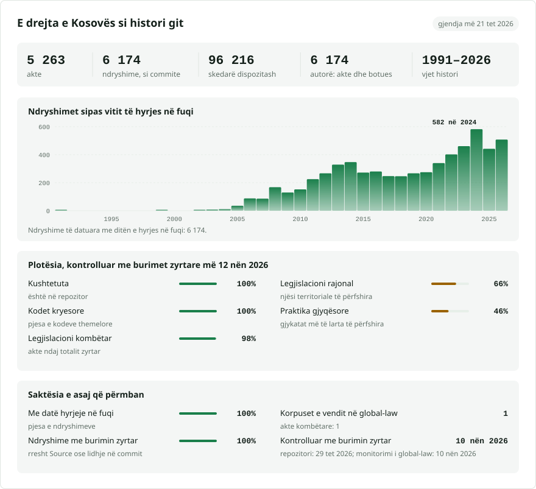

# Kosova: historia e legjislacionit në git

**Shqip** · **[Or read it in English](README.en.md)**

<picture>
<source media="(prefers-color-scheme: dark)" srcset="data/sq/effort-dark.svg">

</picture>

Legjislacioni i Kosovës si histori git: një skedar për çdo nen, një commit për çdo akt në ditën kur hyri në fuqi, dhe vetë akti si autor i commit-it. Gazeta Zyrtare nuk mban versione të konsoliduara të datuara, prandaj çdo akt ruhet siç është miratuar: një akt ndryshues është commit më vete, dhe ndryshimet e tij nuk zbatohen në aktin që ndryshon. `git blame` tregon aktin që qëndron pas çdo neni; `git log` jep ditën kur hyri në fuqi çdo akt; zgjedhja e një date jep aktet që ishin në fuqi atë ditë, siç janë miratuar.

Pjesë e [lexifina/global-law](https://github.com/lexifina/global-law), një histori e vetme git për legjislacionin e çdo vendi: ky është legjislacioni kombëtar i Kosovës, të cilin global-law e lexon te `kosovo/national/acts/`.

**Çfarë përmban tani:** nga lista e ligjeve e Gazetës, Kushtetutën e vitit 2008 dhe pesë amendamentet e saj, 1.020 ligje, 10 kode, 11 aktgjykime të Gjykatës Kushtetuese dhe 1 urdhër, me përkthimin në anglisht të vetë Gazetës; dhe 5.061 akte të kategorive të tjera të saj, me nga një tekst secili: 2.731 aktgjykime, aktvendime dhe mendime të gjyqtarëve, pothuajse të gjitha të Gjykatës Kushtetuese; 653 udhëzime administrative, 645 vendime, 512 rregullore, 179 marrëveshje ndërkombëtare, 78 ligje të tjera dhe 33 dekrete, statute dhe akte të tjera; si dhe 230 akte të 25 komunave. [`laws.csv`](laws.csv) rendit aktet e listës së ligjeve me datat dhe statusin e tyre; [`registry/ACTS.md`](registry/ACTS.md) rendit të tjerat, sipas llojit.

Çdo akt i listës së ligjeve gjendet në `<lloji>/<numri>/` (`ligje/03-l-212/` është Ligji Nr. 03/L-212 i Punës, Gazeta Zyrtare 90/2010; Kushtetuta është `kushtetuta/2008/`); aktet e tjera gjenden në `<lloji>/<viti>/<id e Gazetës>/` (`rregullore/2020/30885/`), ndërsa aktet komunale në `local/<komuna>/<viti>/<id>/`.

Teksti është në shqip, ashtu siç e boton Gazeta Zyrtare; përkthimi në anglisht i vetë Gazetës për aktet e listës së ligjeve gjendet nën `en/` (`en/ligje/03-l-212/article-001.md`).

## Pyetjet si komanda git

| Pyetja | Komanda |
| --- | --- |
| Cilat akte e ndryshojnë ose e shfuqizojnë Ligjin e Punës, ashtu siç i lidh Gazeta? | `grep '^2735,' data/amendments.csv` |
| Cili akt e shkroi çdo rresht të nenit 1? | `git blame ligje/03-l-212/neni-001.md` |
| Commit-i i Ligjit të Punës, me ditën kur hyri në fuqi | `git log --format="%h %(trailers:key=In-force,valueonly,separator=) %an" -- ligje/03-l-212` |
| Neni 1 siç ruhet më 1 janar 2015 | `python tools/in_force_on.py 2015-01-01 ligje/03-l-212 neni-001` |

**Jashtë git-it** këto të dhëna i ofrojmë edhe publikisht, falas:

- **[Pyetni Claude për ligjet e Kosovës](https://global-law.lexifina.com/v1/try_claude?country=kosovo)**: hap Claude me pyetjen e parë gati.
- **[Pyetni ChatGPT](https://global-law.lexifina.com/v1/try_chatgpt?country=kosovo)**: e njëjta pyetje në ChatGPT.
- **[Kërkoni në legjislacionin e Kosovës në faqen tonë](https://lexifina.com/law?country=kosovo&q=pushimi+vjetor)**: kërkim për „pushimi vjetor“, me tekstin e çdo dispozite dhe versionet e saj, pa llogari.
- **[REST API për zhvilluesit](https://global-law.lexifina.com/v1/search_law?query=pushimi+vjetor&jurisdiction=kosovo)**: i njëjti kërkim si JSON, pa çelës. Dokumentimi është [këtu](https://lexifina.com/api/global-law).

Të dy asistentët i lexojnë të dhënat përmes konektorit falas Global law (MCP, `https://global-law.lexifina.com/mcp`); herën e parë biseda ju jep lidhjen që e shton. Pyetni në shqip ose në anglisht.

**Mund ta vini në punë vetë, lehtë.** Mjaftojnë git dhe Python, dhe mjetet punojnë në kompjuterin tuaj:

```sh
git clone --depth 1 https://github.com/lexifina/global-law && cd global-law
python3 tools/countries.py add kosovo/national/acts
python3 tools/law.py show 2026-01-01 kosovo/national/acts/ligje/03-l-212/neni-001.md
```

I hapur në Claude Code, Cursor, VS Code ose Codex, kloni nis edhe një server lokal MCP me të njëjtat mjete ([MCP.md](https://github.com/lexifina/global-law/blob/main/MCP.md)).

## Datat

Çdo commit mban datën në mesditë, sipas orës së Kosovës (Europe/Belgrade), të ditës kur akti hyri në fuqi, dhe këtë ditë e mban edhe në rreshtin përmbyllës `In-force:`:

- dita që jep neni i vetë aktit për hyrjen në fuqi ("Hyrja në fuqi"): një numër ditësh pas publikimit në Gazetë, dita e publikimit, një datë, ose një periudhë pas publikimit;
- për ligjet e viteve 2001-2008 që hynë në fuqi me shpalljen, dhe për 17 akte të listës së ligjeve pa asnjë rregull të gjetur, dita kur i publikoi Gazeta, e shënuar `In-force-basis: published (...)`;
- atje ku pjesë të një akti hyjnë në fuqi më vonë, dita e parë e tij, me të gjithë rregullin të cituar në `In-force-rule:`; 13 aktet që hynë në fuqi para se t'i publikonte Gazeta (ligjet për buxhetin më 1 janar, disa ligje të viteve 2002-2005) shënojnë `In-force-before-publication: yes`;
- një akt i kategorive të tjera, dita e hyrjes në fuqi e të cilit nuk mund të lexohet, mbahet jashtë dhe nuk hamendësohet ([`data/held.json`](data/held.json)).

Autori i çdo commit-i është vetë akti, me një adresë që nuk mund të ekzistojë (`Ligji Nr. 03/L-212 <ligji-03-l-212@gzk.invalid>`), kështu që `git blame` përmend gjithmonë aktin të cilit i përket teksti. Commit-i i një akti që shfuqizoi akte të listës së ligjeve fshin edhe skedarët e tyre dhe i përmend në rreshtat `Repeals:`.

## Sa i përditësuar është

- `python tools/freshness.py <act id or folder>` jep statusin e një akti, verifikimin e tij të fundit dhe faqen e tij në Gazetë.
- [data/status.json](data/status.json): kur e lexoi Gazetën për herë të fundit ekzekutimi i përditësimit dhe nëse Gazeta u përgjigj; [data/pending.json](data/pending.json): aktet e botuara, por ende jo në fuqi.

## Si verifikohet

- Shkronjat e çdo teksti të listës së ligjeve, në të dyja gjuhët, krahasohen me shtresën tekstuale të papërpunuar ose me PDF-në e Gazetës, të lexuara nga një nxjerrës i veçantë minimal (`tools/build/check_words.py`): nga 2.082 tekste, 2.009 i kanë të gjitha shkronjat në vend, 70 kanë të njëjtat fjalë në rend tjetër (qelizat e tabelave dhe shtresat OCR), 2 ndryshojnë vetëm aty ku ndahen fjalët e shkruara me hapësira ndërmjet shkronjave, dhe 1 ndryshon në shkronja (në `REPRODUCE.md`).
- Çdo commit ka `In-force:`; `main` nuk ka bashkime (merge), datat e tij nuk shkojnë kurrë prapa as përtej ditës së ndërtimit, dhe çdo commit është në mesditë.
- Ndërtimi është determinist: dy ndërtime nga të njëjtat faqe japin të njëjtin hash të `main`, dhe sha256 i çdo faqeje dhe PDF-je të lexuar gjendet në [`data/source-sha256.tsv`](data/source-sha256.tsv).
- Aktet e kategorive të tjera shkruhen nga një skedar i vetëm korpusi (`registry/REPRODUCE.md`), të cilin `registry/tools/build/check_repo.py` e krahason me çdo version në git; `registry/REPRODUCE.md` ende nuk shënon asnjë ekzekutim të tij.
- [vulnerabilities/](vulnerabilities/): gabime të mundshme në hartimin e legjislacionit të Kosovës, të gjetura nga detektorët e global-law dhe të kontrolluara me dorë.

## Çfarë nuk tregon

- **Ndryshimet e zbatuara në tekst.** Lexoni aktet ndryshuese së bashku me aktin ([`data/amendments.csv`](data/amendments.csv), 1.117 lidhje). Që nga 2024-09-26 Gazeta ka botuar nga një tekst të konsoliduar për 156 ligje ([`data/consolidated.csv`](data/consolidated.csv)); ato nuk përdoren si histori.
- **8.107 akte të Gazetës që ende nuk janë këtu**, të renditura në [`data/held.json`](data/held.json) bashkë me arsyen: 5.460 të botuara vetëm si faqe të skanuara, 1.427 dita e hyrjes në fuqi e të cilave nuk mund të lexohej, 578 jo në shqip dhe 642 për arsye të tjera.
- **Tekstet në serbisht.** Shqipja dhe serbishtja janë të dyja gjuhë zyrtare (Kushtetuta, neni 5); përdoren vetëm teksti në shqip dhe përkthimi i Gazetës në anglisht.
- **Imazhet dhe formatimi.** Faqet e aneksëve të botuara vetëm si skanime (4.052 në aktet e listës së ligjeve), tabelat si tabela, fusnotat dhe imazhet nuk janë në skedarë.
- **Çdo shfuqizim si fshirje.** Vetëm aktet e listës së ligjeve të shfuqizuara nga një akt tjetër i saj i humbin skedarët; të tjerat i ruajnë, dhe `registry/data/acts.json` jep statusin e tyre (370 të shënuara si të shfuqizuara).

## Burimet

| Burimi | Lloji | Versionet e mëparshme | Shënime |
| --- | --- | --- | --- |
| [Gazeta Zyrtare e Republikës së Kosovës](https://gzk.rks-gov.net) | Gazeta Zyrtare: çdo lloj akti, kombëtar dhe komunal | jo, çdo akt siç është miratuar | Teksti në shqip, përkthimi i tij në anglisht për listën e ligjeve dhe lidhjet ndërmjet akteve |
| Faqet e internetit të komunave ([Fushë Kosova](https://fushekosove.rks-gov.net), [Deçani](https://decan.rks-gov.net)) | Akte komunale | siç janë botuar | 3 akte që Gazeta nuk i boton |

## Licenca

Shih [`LICENSE`](LICENSE). Sipas Ligjit Nr. 08/L-205 për të Drejtën e Autorit dhe të Drejtat e Përafërta, neni 6(1), mbrojtja e të drejtës së autorit nuk përfshin tekstet zyrtare të natyrës legjislative, administrative dhe gjyqësore, as përkthimet zyrtare të tyre; tekstet riprodhohen pa ndryshuar formulimin e tyre. Kontributet e vetë Lexifina-s (mjetet, renditja, mesazhet e commit-eve dhe dokumentimi) janë CC0 1.0.

Asnjë model i inteligjencës artificiale nuk shkroi, nuk përktheu dhe nuk ndryshoi tekst ligjor, dhe asnjë nuk ekzekutohet kur ndërtohet historia; skriptet i shkroi një model i inteligjencës artificiale (shih [`REPRODUCE.md`](REPRODUCE.md) dhe [`registry/REPRODUCE.md`](registry/REPRODUCE.md)).

Ky është përkthim i versionit në anglisht ([README.en.md](README.en.md)); nëse ndryshojnë, vlen versioni në anglisht.

## Vizualizimet

- [visualisations/](visualisations/): grafikë të nxjerrë nga ky depo. Ende pa u vizatuar.

## Më shumë

Nga repozitori [lexifina/global-law](https://github.com/lexifina/global-law) (në anglisht):

- [FEATURES.md](https://github.com/lexifina/global-law/blob/main/FEATURES.md): të gjitha funksionet dhe çfarë duhet të mbështesë çdo korpus (`git blame`, `law.py`, mjetet MCP)
- [FAQ.md](https://github.com/lexifina/global-law/blob/main/FAQ.md): pyetje dhe përgjigje · [CONTRIBUTING.md](https://github.com/lexifina/global-law/blob/main/CONTRIBUTING.md): si të propozoni ndryshime · [MCP.md](https://github.com/lexifina/global-law/blob/main/MCP.md): serveri MCP · [REPRODUCE.md](https://github.com/lexifina/global-law/blob/main/REPRODUCE.md): si është ndërtuar · [CHANGELOG.md](https://github.com/lexifina/global-law/blob/main/CHANGELOG.md)
- [FRESHNESS.md](https://github.com/lexifina/global-law/blob/main/FRESHNESS.md): sa i përditësuar është çdo korpus · [Monitorimi](https://github.com/lexifina/global-law/tree/main/monitoring): nëse përditësimet funksionojnë · [WATCHING.md](https://github.com/lexifina/global-law/blob/main/WATCHING.md): si ndiqet çdo burim zyrtar për ndryshime
- [performance/](https://github.com/lexifina/global-law/tree/main/performance): sa të shpejta janë mjetet, të matura
- [visualisations/](https://github.com/lexifina/global-law/tree/main/visualisations): grafikë dhe lidhje në të drejtën e gjithë botës
- [Dobësitë](https://github.com/lexifina/global-law/tree/main/vulnerabilities): gabime në akte ashtu siç janë botuar
