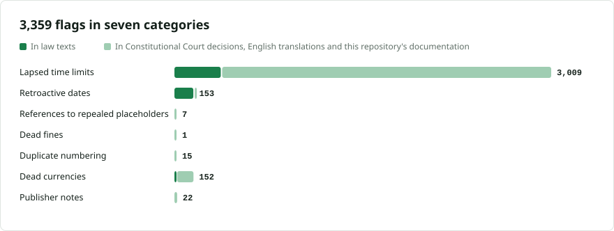

# Vulnerabilities in Kosovo law

[Shqip](README.md) · **English**

<picture>
<source media="(prefers-color-scheme: dark)" srcset="img/flags-by-category-dark.svg">

</picture>

The vulnerability detectors from [lexifina/global-law](https://github.com/lexifina/global-law/tree/main/vulnerabilities) look for mechanical mistakes in legislation: a rule applying "until" a date that has passed, a time limit extended only after it had run out, two amendments to the same act on the same day, a rule in force before it was published. global-law's published list (9 November 2026) did not include Kosovo, so this is a run over this repository only, as it stood at commit [`3750d6a`](https://github.com/lexifina/kosovo-law/commit/3750d6a3416e306fb8bfaad86bc80a793e1bf739) on 15 November 2026. This repository holds each act as enacted: an amending act is a commit of its own, and its changes are not applied to the act it amends. So the detectors that compare an act's versions (same-day conflicts, empty periods, repeal gaps, stale amounts, references to deleted provisions) had almost nothing to compare here, and found nothing.

**In short:** the detectors raised 3,359 flags. A language model reviewed 111 of the strongest, arguing each one for and against; 22 survived. Checked by hand in this repository, none of them looks like a mistake in Kosovo law. 5 come from how this repository dates its acts: the first versions of the agreement establishing the EBRD (ratified by Law No. 04/L-169), of two administrative instructions of 2009 and one of 2007, and of a decision of the Civil Aviation Authority are dated by another date in their text, from 1991 to 2023, not by the day they took effect. 10 are lawful: the act sets its own day, and the Official Gazette published it 60 days to almost nine years later. 1 was misread by a detector, 4 are spent, and 2 are not law. Later, this will be formalised in Lean, similar to our work on [the US tax code](https://lexifina.com/blog/formalizing-the-us-tax-code) and [US case law](https://lexifina.com/blog/formalizing-all-us-case-law-in-lean).

A flag is a prompt to look, not legal advice, and nothing here has been tested in court.

## Flags by category

| Category | What it looks for | Flags | In law texts | Reviewed | Survived review |
| --- | --- | ---: | ---: | ---: | ---: |
| Lapsed time limits | Text still applying a rule "until" a date that has passed | 3,009 | 370 | 71 | 6 |
| Retroactive or pre-publication dates | A rule in force before it was made or published | 153 | 151 | 40 | 16 |
| References to repealed placeholders | A provision citing an article whose text is only "deleted" | 7 | 0 | 0 | 0 |
| Dead fines | A penalty for breaching an article that has been repealed | 1 | 0 | 0 | 0 |
| Duplicate numbering | Two units with the same number in one provision | 15 | 0 | 0 | 0 |
| Dead currencies | Amounts in currencies no longer in use | 152 | 10 | 0 | 0 |
| Publisher notes | Notes that an amendment could not be carried out | 22 | 0 | 0 | 0 |

"In law texts" counts the Constitution and its amendments, laws and codes, decrees, regulations, administrative instructions, the decisions of the Assembly, the Government, ministries and other bodies, statutes, rules, administrative orders, international agreements and municipal acts. The other flags are in the Constitutional Court's judgments, rulings, decisions and judges' opinions (`aktgjykim/`, `aktgjykime/`, `aktvendim/`, `mendim/`, `urdher/`, `urdhera/`, and 325 more filed among the decisions and regulations), in the Gazette's English translations (`en/`), which are not the law text, and in `registry/`. The search for same-day conflicts, empty periods, repeal gaps, stale amounts and references to deleted provisions found nothing to flag.

*Edge cases: the 22 flags that survived the review, grouped by what they turned out to be, and what the other flags are, in [EDGE-CASES.en.md](EDGE-CASES.en.md).*

## Problems found in this repository

- **First versions dated by another date in their text:** at least 16 acts are in force in this repository from a day their own in-force rule does not give. In the list of laws, Law No. 08/L-093 (amending the law on plant protection products) is dated 4 August 2022, the day under its signature, though it "hyn në fuqi pesëmbëdhjetë (15) ditë pas publikimit" and was published on 26 August 2022; and four budget laws (07/L-001, 10/L-001, 06/L-133 and 06/L-020) are dated 1 January, the day of their "efekt financiar", though each "hyn në fuqi ditën e publikimit" (19 March 2020, 2 March 2026, 14 February 2019 and 9 January 2018). So the README's 13 acts of the list of laws in force before publication are 8. Among the other acts, the date is taken from another sentence: the deadline in the EBRD agreement's own clause on its entry into force (31 March 1991; the ratifying law took effect on publication, 13 December 2012, and is held correctly in `ligje/04-l-169/`), the date of the instruction it repeals (Administrative Instruction No. 32/2009), of the Government decision it implements (No. 15/2009), of the incident it deals with (Civil Aviation Authority decision No. 04-2023), of the day the law on the Independent Oversight Board for the Civil Service took effect (the Assembly's decision No. 04-V-378 approving the Board's 2011 report) and of a privatisation moratorium (the Mining Strategy 2012–2025); four administrative instructions of the Ministry of Labour and Social Welfare (No. 7/2004, 05/2005, 06/2005 and 04/2007) are dated from the day they apply from, though each takes effect on signature or "menjëherë"; and a Constitutional Court decision on non-enforcement is dated by the judgment it concerns. 6 of the 22 survivors ([Edge cases](EDGE-CASES.en.md)).
- **Constitutional Court decisions filed among the acts:** `vendim/` holds 324 decisions of the Constitutional Court (inadmissibility, interim measures, rejections) beside 321 decisions of the Assembly, the Government and other bodies, `rregullore/2026/117563/` is a ruling of the Court, and `urdher/` holds only a Court decision on an interim measure. The folder of a kind does not tell law from case law; here they were told apart by the Gazette's short codes (`GJK-...`) and the case numbers in their titles.
- **A file can hold more than its article:** `ligje/07-l-014/neni-012.md`, the last article of Law No. 07/L-014 (revising the 2020 budget), holds its in-force clause and with it all the budget tables and their explanation, about 1.4 MB (1 of the 22 survivors).

## Files

| File | What it holds |
| --- | --- |
| [data/flags.csv](data/flags.csv) | Every flag, one row per provision and issue |
| [data/reviewed.csv](data/reviewed.csv) | The 111 flags the model reviewed, with its verdict and reason |
| [data/by_category.csv](data/by_category.csv) | The counts in the table above |
| [tools/](tools/) | The scripts that made this run |

Columns: `category` and `category_sq` (the category in English and Albanian), `detector`, `kind` (`law` or `other`), `path` (the file in this repository), `date` (the date the flag turns on), `reference` (the act or line involved), `summary`, `score` (the detector's ranking, 0 to 1), `review` (`artefact`, `lawful` or `candidate_defect`), `survives_rebuttal`, `review_note` (the model's reason, in English), `url` (the provision at the commit that was read; for retroactive dates, the commit that dated the act).

## How it was made

- **Detectors:** global-law's [vulnerabilities/scripts](https://github.com/lexifina/global-law/tree/main/vulnerabilities/scripts), run on this repository at commit `3750d6a`, with every fix found by the runs on other country repositories. global-law's published list did not include Kosovo, so the history table the detectors read was built from this repository's own commits (the author, the act that made each change, and the `In-force` and `Kind` trailers; the kinds `enacted`, `decree`, `law` and `treaty` count as changes to the law, while `court`, the Constitutional Court's judgments and opinions, does not). The time-limit search was taught the forms of "deri" (until) that Kosovo's texts use: "deri me" without its diacritic, "deri mé" and "deri m€" where the Gazette's text layer prints "ë" as "é" or "€", "deri" right before a date, and "datë" before the date in those prints ("deri me daté 10 shtator 2021") or as "dt.". Of the 349 places in law texts where "deri" is followed by a date that has passed, it reads 338; 5 of the other 11 put "të vitit" before the year ("deri më 30 nëntor të vitit 2024").
- **Model review:** gpt-5.4-mini, the 40 strongest flags per category, and for lapsed time limits also the 40 strongest in law texts; one pass says whether a flag is real, a second argues that it is not. After each fix to "deri", every review already made was kept and the strongest new flags were reviewed (71 lapsed time limits in all). There were no empty periods to review. global-law's own list used a different model.
- **Hand check:** every case that survived was read in this repository's texts and history: the act's own in-force rule, its date and signature, and its publication day in the Gazette.

To report a correction, open an issue with the provision and an official source.

## Licence

The lists and notes are Lexifina's, dedicated to the public domain under CC0 1.0, like the rest of this repository's own contributions. Quoted law text is as the Gazeta Zyrtare e Republikës së Kosovës publishes it; under Law No. 08/L-205 on Copyright and Related Rights, article 6(1), copyright does not extend to official texts of a legislative, administrative and judicial nature, nor to their official translations; see [LICENSE](../LICENSE).
