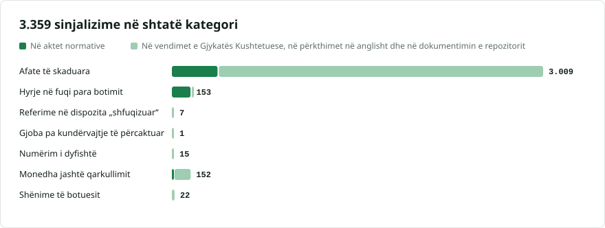

# Dobësi në legjislacionin e Kosovës

**Shqip** · [English](README.en.md)

<picture>
<source media="(prefers-color-scheme: dark)" srcset="img/flags-by-category-dark.sq.svg">

</picture>

Detektorët e dobësive të repozitorit [lexifina/global-law](https://github.com/lexifina/global-law/tree/main/vulnerabilities) kërkojnë gabime mekanike në legjislacion: një rregull që ende zbatohet „deri më“ një datë që ka kaluar, një afat i zgjatur vetëm pasi kishte skaduar, dy ndryshime të të njëjtit akt në të njëjtën ditë, një rregull në fuqi para se të botohej. Lista që global-law publikoi më 9 nëntor 2026 nuk e përfshinte Kosovën, prandaj ky është një kontroll vetëm i këtij repozitori, në gjendjen e commit-it [`3750d6a`](https://github.com/lexifina/kosovo-law/commit/3750d6a3416e306fb8bfaad86bc80a793e1bf739) të 15 nëntorit 2026. Ky repozitor e ruan çdo akt ashtu siç është miratuar: akti ndryshues është commit më vete, dhe ndryshimet e tij nuk zbatohen në aktin që ndryshon. Prandaj detektorët që krahasojnë versionet e një akti (ndryshime në të njëjtën ditë, periudha boshe, boshllëqe pas shfuqizimit, shuma të vjetruara, referime në dispozita të shfuqizuara) këtu nuk kishin pothuajse asgjë për të krahasuar, dhe nuk gjetën asgjë.

**Shkurt:** detektorët dhanë 3.359 sinjalizime. Një model gjuhësor shqyrtoi 111 më të fortët, duke peshuar për secilin argumentet pro dhe kundër; 22 qëndruan. Të kontrolluara me dorë në këtë repozitor, asnjëra prej tyre nuk duket si gabim në të drejtën e Kosovës. 5 vijnë nga mënyra si ky repozitor i daton aktet: versionet e para të marrëveshjes për themelimin e BERZH-it (të ratifikuar me Ligjin Nr. 04/L-169), të dy udhëzimeve administrative të vitit 2009 dhe të një të vitit 2007, si dhe të një vendimi të Autoritetit të Aviacionit Civil janë datuar me një datë tjetër nga teksti i tyre, nga viti 1991 deri në vitin 2023, e jo me ditën kur hynë në fuqi. 10 janë të ligjshme: akti e cakton vetë ditën e hyrjes në fuqi, dhe Gazeta Zyrtare e botoi nga 60 ditë deri në gati nëntë vjet më vonë. 1 është lexuar gabim nga detektori, 4 janë shteruar dhe 2 nuk janë akte normative. Më vonë kjo do të formalizohet në Lean, ngjashëm me punën tonë për [kodin tatimor të SHBA-së](https://lexifina.com/blog/formalizing-the-us-tax-code) dhe [praktikën gjyqësore të SHBA-së](https://lexifina.com/blog/formalizing-all-us-case-law-in-lean).

Një sinjalizim është ftesë për ta parë më nga afër, jo këshillë ligjore, dhe asgjë këtu nuk është provuar para gjykatës.

## Sinjalizimet sipas kategorisë

| Kategoria | Çfarë kërkon | Sinjalizime | Në aktet normative | Të shqyrtuara | Qëndruan pas shqyrtimit |
| --- | --- | ---: | ---: | ---: | ---: |
| Afate të skaduara | Tekst që ende zbaton një rregull „deri më“ një datë që ka kaluar | 3.009 | 370 | 71 | 6 |
| Hyrje në fuqi para botimit | Rregull në fuqi para se të miratohej ose të botohej | 153 | 151 | 40 | 16 |
| Referime në dispozita „shfuqizuar“ | Dispozitë që citon një nen, teksti i të cilit është vetëm „fshihet“ | 7 | 0 | 0 | 0 |
| Gjoba pa kundërvajtje të përcaktuar | Dënim për shkeljen e një neni që është shfuqizuar | 1 | 0 | 0 | 0 |
| Numërim i dyfishtë | Dy njësi me të njëjtin numër në një dispozitë | 15 | 0 | 0 | 0 |
| Monedha jashtë qarkullimit | Shuma në monedha që nuk përdoren më | 152 | 10 | 0 | 0 |
| Shënime të botuesit | Shënime se një ndryshim nuk mund të pasqyrohej | 22 | 0 | 0 | 0 |

„Në aktet normative“ përfshin Kushtetutën dhe amendamentet e saj, ligjet dhe kodet, dekretet, rregulloret, udhëzimet administrative, vendimet e Kuvendit, të Qeverisë, të ministrive dhe të organeve të tjera, statutet, rregullat, urdhëresat administrative, marrëveshjet ndërkombëtare dhe aktet e komunave. Sinjalizimet e tjera janë në aktgjykimet, aktvendimet, vendimet dhe mendimet e gjyqtarëve të Gjykatës Kushtetuese (`aktgjykim/`, `aktgjykime/`, `aktvendim/`, `mendim/`, `urdher/`, `urdhera/`, dhe 325 të tjera të vendosura ndër vendimet dhe rregulloret), në përkthimet e Gazetës në anglisht (`en/`), që nuk janë teksti i ligjit, dhe në `registry/`. Kërkimi për ndryshime në të njëjtën ditë, periudha boshe, boshllëqe pas shfuqizimit, shuma të vjetruara dhe referime në dispozita të shfuqizuara nuk gjeti asgjë për të sinjalizuar.

*Rastet kufitare: 22 sinjalizimet që qëndruan pas shqyrtimit, të grupuara sipas asaj që rezultuan të jenë, dhe çfarë janë sinjalizimet e tjera, në [EDGE-CASES.md](EDGE-CASES.md).*

## Probleme të gjetura në këtë repozitor

- **Versione të para të datuara me një datë tjetër nga teksti i tyre:** të paktën 16 akte janë në fuqi në këtë repozitor nga një ditë që nuk e cakton dispozita e tyre për hyrjen në fuqi. Në listën e ligjeve, Ligji Nr. 08/L-093 (për ndryshimin dhe plotësimin e ligjit për produktet për mbrojtjen e bimëve) është datuar me 4 gusht 2022, datën nën nënshkrimin e tij, ndonëse „hyn në fuqi pesëmbëdhjetë (15) ditë pas publikimit“ dhe u publikua më 26 gusht 2022; dhe katër ligje për buxhetin (07/L-001, 10/L-001, 06/L-133 dhe 06/L-020) janë datuar me 1 janar, ditën e „efektit financiar“, ndonëse secili „hyn në fuqi ditën e publikimit“ (19 mars 2020, 2 mars 2026, 14 shkurt 2019 dhe 9 janar 2018). Kështu, 13 aktet e listës së ligjeve që sipas README-së hynë në fuqi para publikimit janë 8. Ndër aktet e tjera, data është marrë nga një fjali tjetër: afati në dispozitën e vetë marrëveshjes së BERZH-it për hyrjen e saj në fuqi (31 mars 1991; ligji i ratifikimit hyri në fuqi ditën e publikimit, më 13 dhjetor 2012, dhe ruhet me ditën e saktë në `ligje/04-l-169/`), data e udhëzimit që shfuqizon (Udhëzimi Administrativ Nr. 32/2009), e vendimit të Qeverisë që zbaton (Nr. 15/2009), e incidentit që trajton (vendimi Nr. 04-2023 i Autoritetit të Aviacionit Civil), dita kur hyri në fuqi ligji për Këshillin e Pavarur Mbikëqyrës për Shërbimin Civil të Kosovës (vendimi i Kuvendit Nr. 04-V-378 për miratimin e raportit vjetor të Këshillit për vitin 2011) dhe dita e një moratoriumi të privatizimit (Strategjia Minerare e Republikës së Kosovës për periudhën 2012–2025); katër udhëzime administrative të Ministrisë së Punës dhe Mirëqenies Sociale (Nr. 7/2004, 05/2005, 06/2005 dhe 04/2007) janë datuar me ditën nga e cila zbatohen, ndonëse secili hyn në fuqi ditën e nënshkrimit ose „menjëherë“; dhe një vendim i Gjykatës Kushtetuese për mospërmbarim është datuar me aktgjykimin që trajton. 6 nga 22 sinjalizimet që qëndruan ([rastet kufitare](EDGE-CASES.md)).
- **Vendime të Gjykatës Kushtetuese të vendosura ndër aktet:** `vendim/` mban 324 vendime të Gjykatës Kushtetuese (për papranueshmëri, për masa të përkohshme, për refuzim të kërkesës) pranë 321 vendimeve të Kuvendit, të Qeverisë dhe të organeve të tjera, `rregullore/2026/117563/` është një aktvendim i Gjykatës, dhe `urdher/` mban vetëm një vendim të Gjykatës për një masë të përkohshme. Dosja e një lloji akti nuk e dallon aktin normativ nga praktika gjyqësore; këtu ato u dalluan sipas kodeve të shkurtra të Gazetës (`GJK-...`) dhe numrave të rasteve në titujt e tyre.
- **Një skedar mund të mbajë më shumë se neni i vet:** `ligje/07-l-014/neni-012.md`, neni i fundit i Ligjit Nr. 07/L-014 (për ndryshimin e buxhetit të vitit 2020), mban dispozitën për hyrjen në fuqi dhe bashkë me të të gjitha tabelat e buxhetit dhe shpjegimin e tyre, rreth 1,4 MB (1 nga 22 sinjalizimet që qëndruan).

## Skedarët

| Skedari | Çfarë përmban |
| --- | --- |
| [data/flags.csv](data/flags.csv) | Çdo sinjalizim, një rresht për dispozitë dhe problem |
| [data/reviewed.csv](data/reviewed.csv) | 111 sinjalizimet që shqyrtoi modeli, me vlerësimin dhe arsyetimin e tij |
| [data/by_category.csv](data/by_category.csv) | Numrat e tabelës më sipër |
| [tools/](tools/) | Skriptet me të cilat u bë ky kontroll |

Kolonat: `category` dhe `category_sq` (kategoria në anglisht dhe në shqip), `detector`, `kind` (`law` ose `other`), `path` (skedari në këtë repozitor), `date` (data me të cilën lidhet sinjalizimi), `reference` (akti ose rreshti në fjalë), `summary`, `score` (renditja e detektorit, nga 0 në 1), `review` (`artefact`, `lawful` ose `candidate_defect`), `survives_rebuttal`, `review_note` (arsyetimi i modelit, në anglisht), `url` (dispozita në commit-in që u lexua; për hyrjen në fuqi para botimit, commit-i që e datoi aktin).

## Si u bë

- **Detektorët:** [vulnerabilities/scripts](https://github.com/lexifina/global-law/tree/main/vulnerabilities/scripts) i global-law, të ekzekutuar mbi këtë repozitor në commit-in `3750d6a`, me të gjitha korrigjimet e gjetura gjatë kontrolleve të repozitorëve të vendeve të tjera. Lista e publikuar e global-law nuk e përfshinte Kosovën, prandaj tabela e historisë që lexojnë detektorët u ndërtua nga vetë commit-et e këtij repozitori (autori, pra akti që bëri çdo ndryshim, dhe trailer-at `In-force` dhe `Kind`; llojet `enacted`, `decree`, `law` dhe `treaty` llogariten si ndryshime të së drejtës, ndërsa `court`, aktgjykimet dhe mendimet e Gjykatës Kushtetuese, jo). Kërkimi i afateve u mësua të lexojë format e „deri“ që përdorin tekstet e Kosovës: „deri me“ pa shenjë diakritike, „deri mé“ dhe „deri m€“ aty ku shtresa tekstuale e Gazetës e shtyp „ë“-në si „é“ ose „€“, „deri“ menjëherë para një date, dhe „datë“ para datës në këto shtypje („deri me daté 10 shtator 2021“) ose si „dt.“. Nga 349 vendet në aktet normative ku „deri“ pasohet nga një datë që ka kaluar, ai lexon 338; 5 nga 11 të tjerat e vënë „të vitit“ para vitit („deri më 30 nëntor të vitit 2024“).
- **Shqyrtimi nga modeli:** gpt-5.4-mini, 40 sinjalizimet më të forta për çdo kategori, dhe për afatet e skaduara edhe 40 më të fortët në aktet normative; një kalim thotë nëse sinjalizimi është i vërtetë, një i dytë argumenton se nuk është. Pas çdo korrigjimi të „deri“-së, çdo shqyrtim i bërë më parë u ruajt dhe u shqyrtuan sinjalizimet e reja më të forta (71 afate të skaduara gjithsej). Nuk pati periudha boshe për t'u shqyrtuar. Lista e vetë global-law përdori një model tjetër.
- **Kontrolli me dorë:** çdo rast që qëndroi u lexua në tekstet dhe historinë e këtij repozitori: dispozita e vetë aktit për hyrjen në fuqi, data dhe nënshkrimi i tij, dhe dita kur e botoi Gazeta.

Një korrigjim mund ta raportoni duke hapur një issue me dispozitën dhe një burim zyrtar.

## Licenca

Listat dhe shënimet janë vepër e Lexifina-s, të vëna në domenin publik sipas CC0 1.0, si edhe kontributet e tjera të vetë këtij repozitori. Teksti ligjor i cituar është ashtu siç e boton Gazeta Zyrtare e Republikës së Kosovës; sipas Ligjit Nr. 08/L-205 për të Drejtën e Autorit dhe të Drejtat e Përafërta, neni 6(1), mbrojtja e të drejtës së autorit nuk përfshin tekstet zyrtare të natyrës legjislative, administrative dhe gjyqësore, as përkthimet zyrtare të tyre; shih [LICENSE](../LICENSE).

Ky është përkthim i versionit në anglisht ([README.en.md](README.en.md)); nëse ndryshojnë, vlen versioni në anglisht.
